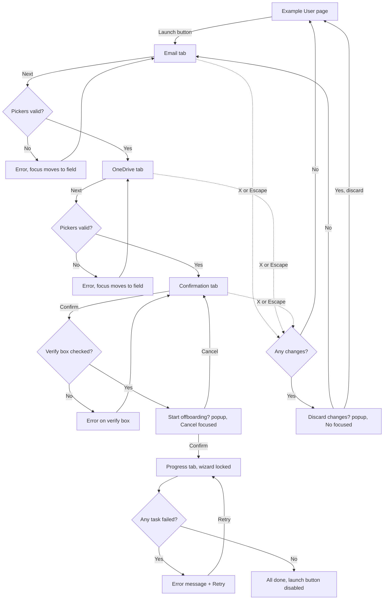

# OffboardingWizard
Case Study 2
**Live prototype:** https://psyberpoison.github.io/OffboardingWizard/

This is my redesign of the user offboarding process for the Office admin portal.
None of the test users are real.
The licenses are hard-coded in, not variable. So are their descriptions.
Loading times are simulated.
One of the users (Marcus Lee) starts disabled for the picker testing.
The license removal is designed to fail on the first attempt to show what it looks like.

